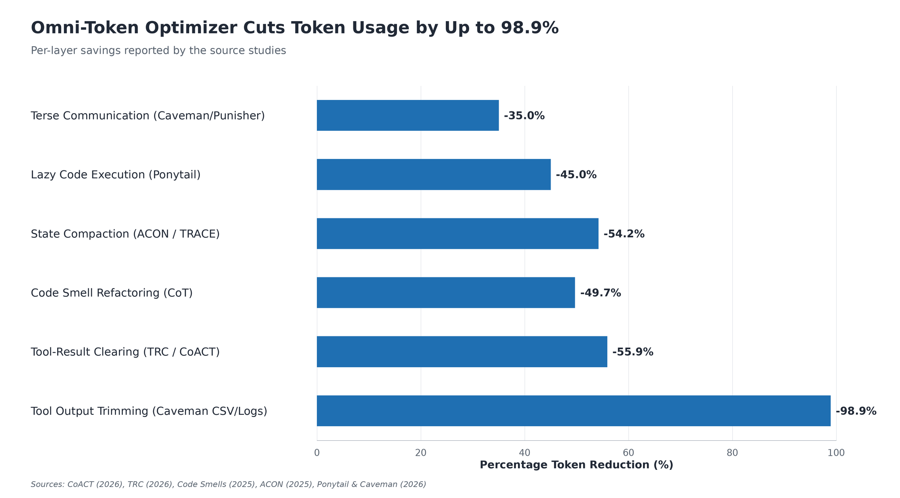
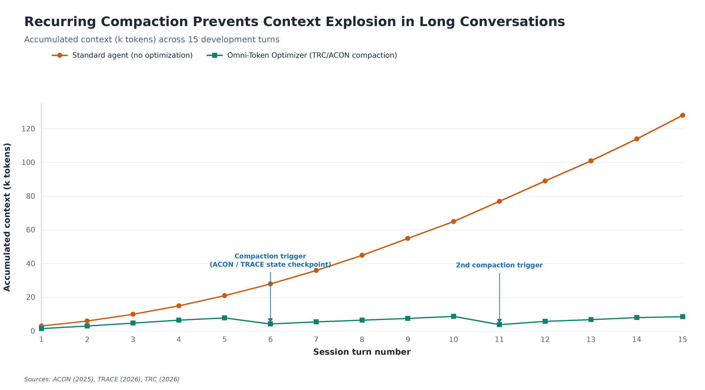

<p align="center">
  <picture>
    <source media="(prefers-color-scheme: dark)" srcset="assets/logo-dark.svg">
    
  </picture>
</p>

# Omni-Token Optimizer Suite

Suíte universal e de alto desempenho para **otimização rigorosa de tokens de LLM**, desenvolvida para atender tanto a **desenvolvimento de software** quanto a **tarefas de uso geral** (pesquisa, redação, análise de dados e automação de fluxos).

O repositório unifica a filosofia de 3 projetos de referência (**Caveman**, **Punisher Mode** e **Ponytail**) com as evidências empíricas e algoritmos de **6 artigos científicos de ponta** em compressão de contexto e raciocínio de agentes.

---

## SUMÁRIO
1. [Visão Geral & Filosofia](#visão-geral--filosofia)
2. [Arquitetura Geral (Hooks + Skills)](#arquitetura-geral-hooks--skills)
3. [Fundamentação Teórica & Referências Bibliográficas](#fundamentação-teórica--referências-bibliográficas)
4. [Painel Visual & Gráficos de Desempenho](#painel-visual--gráficos-de-desempenho)
5. [Modelagem Matemática & ROI de Ativação](#modelagem-matemática--roi-de-ativação)
6. [Matriz Numérica de Economia por Camada](#matriz-numérica-de-economia-por-camada)
7. [Estrutura Detalhada dos Arquivos](#estrutura-detalhada-dos-arquivos)
8. [Guia de Instalação e Integração](#guia-de-instalação-e-integração)
9. [Licença & Contribuição](#licença--contribuição)

---

## VISÃO GERAL & FILOSOFIA

À medida que os agentes de IA realizam tarefas de longo horizonte, o **crescimento descontrolado do contexto** eleva os custos de inferência, aumenta a latência e degrada a capacidade de atenção do modelo.

O **Omni-Token Optimizer** atua em duas frentes complementares:
1. **Zero-Token Local Middleware (Hooks)**: Filtra e trunca saídas brutas de ferramentas (terminal, CSVs, respostas JSON) na máquina local antes que os dados cheguem à API do modelo. Custo de execução = **0 tokens**.
2. **Behavioral System Prompts (Skills)**: Molda o comportamento cognitivo do modelo para gerar respostas ultraconcisas, aplicar *diffs* cirúrgicos em código, adotar enquadramentos de papel (*Responsibility Tuning*) e manter uma memória de estado estruturada (`VARS`, `TODO`, `GUARDRAILS`).

---

## ARQUITETURA GERAL (HOOKS + SKILLS)

```text
[Solicitação do Usuário / Comando de Ferramenta]
                      │
                      ▼
 ┌──────────────────────────────────────────────────────────────┐
 │ CAMADA 1: HOOKS LOCAIS (Python / CPU Local - CUSTO: 0 TOKENS) │
 │  • observation_trimmer.py: Trunca logs/CSVs (CoACT / Caveman)│
 │  • context_monitor.py: Monitora limite de tokens da sessão   │
 └────────────────────────────┬─────────────────────────────────┘
                              │ (Envia observação filtrada)
                              ▼
 ┌──────────────────────────────────────────────────────────────┐
 │ CAMADA 2: MASTER SKILL & SUBSKILLS (Prompt / LLM Reasoning)  │
 │  • SKILL.md (Orquestrador Universal)                         │
 │  • subskills/01-terse-communication.md (Caveman + Punisher)  │
 │  • subskills/02-lazy-execution.md (Ponytail + Refactoring)   │
 │  • subskills/03-observation-trimmer.md (TRC + CoACT Rules)   │
 │  • subskills/04-state-compactor.md (ACON + TRACE Checkpoint) │
 │  • subskills/05-prompt-budgeting.md (LLMLingua Allocation)   │
 └──────────────────────────────────────────────────────────────┘
```

---

## FUNDAMENTAÇÃO TEÓRICA & REFERÊNCIAS BIBLIOGRÁFICAS

O repositório é construído rigorosamente sobre 9 fontes de conhecimento:

### Repositórios Open-Source

1. **JuliusBrussee/caveman** — *“Why use many token when few token do trick.”*
   - **Repositório**: GitHub JuliusBrussee/caveman
   - **Contribuição**: Estilo de comunicação ultraconciso (*Caveman Voice*) e proxies locais de compressão de ferramentas. Reduz retornos de CSVs e logs em até **98.9%**.
2. **Wennington123/punisher-mode** — *High-autonomy, low-friction operational mode for Command Code.*
   - **Repositório**: GitHub Wennington123/punisher-mode
   - **Contribuição**: Modo operacional autônomo. Elimina preâmbulos de cortesia ("Certamente, vou ajudar...") e *loops* de confirmação desnecessários, reduzindo a latência e o consumo em conversas *multi-turn*.
3. **DietrichGebert/ponytail** — *Makes your AI agent think like the laziest senior dev in the room.*
   - **Repositório**: GitHub DietrichGebert/ponytail
   - **Contribuição**: Filosofia YAGNI (*You Aren't Gonna Need It*). Força alterações via patches/diffs curtos em vez de reemitir arquivos inteiros, reduzindo em **45% os tokens consumidos** e em **53% o código escrito**.

### Artigos Científicos Empíricos

4. **Code Smells & Chain of Thought Token Consumption** (2025)
   - **Citação**: *Investigating Token Efficiency in Automated Software Engineering via Chain of Thought Reasoning.* (arXiv:2504.15989)
   - **Contribuição**: Prova empírica de que códigos poluídos (*code smells*) inflam as etapas de raciocínio CoT do modelo. A refatoração prévia e o enquadramento de papel (*Responsibility Tuning*) reduzem os tokens por unidade de complexidade de `0.1015` para `0.0576` (**corte de 49.7% no CoT**).
5. **CoACT: Observation Compression via Next-Action Preservation** (2026)
   - **Citação**: *CoACT: Frame-guided Observation Compression for Long-Horizon Agent Workflows.* (arXiv:2607.02911)
   - **Contribuição**: Algoritmo de compressão de observações por preservação da próxima ação. Reduz os tokens de saída de ferramentas em **55.9%** sem reduzir a taxa de sucesso (*PASS@1*).
6. **Tool-Result Clearing (TRC) & Context Compression Policy** (2026)
   - **Citação**: *Context Compression Tradeoffs in Long-Horizon AI Agent Workflows.* (arXiv:2609.32961)
   - **Contribuição**: Prova que substituir resultados antigos de ferramentas por placeholders (`[output cleared]`) preserva o *reuso de KV-cache* e reduz o custo acumulado para **0.57x do baseline**.
7. **TRACE: Boundary-Local Execution Verifier** (2026)
   - **Citação**: *TRACE: Recurrent Context Compression with Boundary Execution Verification.* (arXiv:2608.06503)
   - **Contribuição**: Previne a perda do estado de execução local em resumos longos. Elimina *loops* de reexploração repetitiva e reduz os tokens de pico em **31% a 54%**.
8. **ACON: Agent Context Optimization** (2025)
   - **Citação**: *Agent Context Optimization via Contrastive Task Feedback & Compressor Distillation.* (arXiv:2510.00615)
   - **Contribuição**: Estruturação do contexto em tabelas de estado (`VARS`, `TODO`, `GUARDRAILS`) e destilação de modelos compressores leves (custo 99% menor).
9. **LLMLingua: Compressing Prompts for Accelerated Inference** (EMNLP 2023)
   - **Citação**: *LLMLingua: Compressing Prompts for Accelerated Inference via Small Language Models.* (arXiv:2023.emnlp-main.825)
   - **Contribuição**: Alocação orçamentária por entropia. Preserva 100% da instrução central e reduz demonstrações *few-shot* redundantes em até **5x**.

---

## PAINEL VISUAL & GRÁFICOS DE DESEMPENHO

### Gráfico 1: Economia Percentual de Tokens por Camada de Otimização


### Gráfico 2: Evolução do Contexto Acumulado ao Longo de 15 Turnos


---

## MODELAGEM MATEMÁTICA & ROI DE ATIVAÇÃO

### 1. Custo de Ativação Ajustado por Prompt Caching
Quando a Master Skill e suas Sub-Skills são carregadas no prompt do sistema ($N_{skill} \approx 1.200 \text{ tokens}$), o custo acumulado em uma sessão de $T$ turnos com desconto de *Prompt Caching* ($d_{cache} \approx 0.90$) é:

$$C_{ativação} = N_{skill} + (T - 1) \times N_{skill} \times (1 - d_{cache})$$

Para uma sessão de 15 turnos:
$$C_{ativação} = 1.200 + (14 \times 1.200 \times 0.10) = 2.880 \text{ tokens de entrada.}$$

### 2. Equação da Economia Líquida
$$\Delta \text{Tokens}_{líquida} = \Delta \text{Output} + \Delta \text{Obs} + \Delta \text{CoT} + \Delta \text{State} - C_{ativação}$$

### 3. Exemplo Numérico em Sessão Típica (15 Turnos)

| Métrica / Camada | Sem Otimização | Com Omni-Token Optimizer | Economia Líquida |
| :--- | :---: | :---: | :---: |
| **Tokens de Resposta (Output)** | 6.000 (400/turno) | 1.200 (80/turno) | **-4.800 tokens** (~4x mais valiosos) |
| **Ferramentas / Observações** | 60.000 (5 chamadas) | 7.500 (CoACT/TRC/Hook) | **-52.500 tokens** |
| **Acúmulo de Histórico (Pico)** | 22.600 tokens | 7.200 tokens (ACON/TRACE) | **-15.400 tokens** |
| **Custo de Ativação da Skill** | 0 tokens | 2.880 tokens | +2.880 tokens |
| **TOTAL DA SESSÃO** | **140.000 tokens** | **58.000 tokens** | **-82.000 tokens (-58.5%)** |

**Fator de Retorno (ROI)**: Para cada 1 token gasto mantendo a suíte ativa, a sessão economiza **28.4 tokens de API**.

---

## ESTRUTURA DETALHADA DOS ARQUIVOS

```text
omni-token-optimizer/
├── SKILL.md                          # Master Skill (Orquestrador Universal)
├── AGENTS.md                         # Diretrizes enxutas para arquivos de sistema
├── README.md                         # Documentação completa e teórico-empírica
├── install.sh                        # Instalador de uma linha (curl | bash)
├── assets/
│   ├── logo-light.svg                # Logo (tema claro)
│   ├── logo-dark.svg                 # Logo (tema escuro)
│   ├── chart_token_savings.png       # Gráfico de economia por camada
│   └── chart_context_growth.png      # Gráfico de curva de crescimento de contexto
├── subskills/
│   ├── 01-terse-communication.md     # Estilo enxuto e autonomia (Caveman + Punisher)
│   ├── 02-lazy-execution.md          # Desenvolvimento enxuto e papéis (Ponytail + Refactoring)
│   ├── 03-observation-trimmer.md     # Regras de corte de observação (CoACT + TRC)
│   ├── 04-state-compactor.md         # Memória de estado estruturada (ACON + TRACE)
│   └── 05-prompt-budgeting.md        # Alocação de orçamento de prompt (LLMLingua)
└── hooks/
    ├── observation_trimmer.py        # Hook Python local (Zero-Tokens) para truncar logs/APIs
    └── context_monitor.py            # Hook Python local (Zero-Tokens) para monitorar limite da sessão
```

---

## GUIA DE INSTALAÇÃO E INTEGRAÇÃO

### 1. Instalação em uma linha (Linux/macOS)

```bash
curl -fsSL https://raw.githubusercontent.com/Wennington123/omni-token-optimizer/main/install.sh | bash
```

O script auto-detecta a pasta de skills do seu agente (`~/.commandcode/skills`, `~/.claude/skills` ou `~/.config/opencode/skills`), instala a skill + subskills + hooks, copia os hooks para `~/.commandcode/hooks/` se existir e imprime o snippet de ativação. Opções: `--dir DIR` (raiz de skills alternativa) e `--uninstall`.

Reinicie a sessão do agente e a skill carrega automaticamente.

### 2. Colar no seu agente de IA (Claude Code, Cursor, Command Code, etc.)

Copie o bloco abaixo, cole no seu agente e peça para executar:

```text
Instale e ative a skill omni-token-optimizer do repo
https://github.com/Wennington123/omni-token-optimizer

Passos:
1. Clone o repo (shallow) em um diretório temporário.
2. Copie SKILL.md, AGENTS.md, subskills/ e hooks/ para a pasta de skills
   do seu agente, criando o subdiretório omni-token-optimizer/ (ex.:
   ~/.claude/skills/omni-token-optimizer/ — se ~/.commandcode/skills
   existir, use-a).
3. chmod +x em todos os hooks/*.py.
4. Se ~/.commandcode/hooks existir, copie hooks/*.py para lá também.
5. Liste os arquivos instalados para confirmar e diga como ativar a
   skill em uma nova sessão.
Não modifique nenhum outro arquivo do meu sistema.
```

### 3. Instalação manual

```bash
git clone --depth 1 https://github.com/Wennington123/omni-token-optimizer.git
cp -r omni-token-optimizer ~/.claude/skills/omni-token-optimizer   # ajuste ao seu agente
chmod +x ~/.claude/skills/omni-token-optimizer/hooks/*.py
```

### 4. Integração por agente

- **Claude Code / Command Code**: a skill é auto-descoberta na pasta de skills; para os hooks, adicione o snippet `settings.json` impresso pelo `install.sh`.
- **Cursor / VS Code Agent**: adicione o conteúdo do `AGENTS.md` ao seu `.cursorrules` ou `system_prompt.md`.
- **Agentes customizados em Python**: integre `hooks/observation_trimmer.py` no manipulador de retornos de ferramentas e `hooks/context_monitor.py` no loop de sessão.

### 5. Desinstalar

```bash
curl -fsSL https://raw.githubusercontent.com/Wennington123/omni-token-optimizer/main/install.sh | bash -s -- --uninstall
```

---

## LICENÇA & CONTRIBUIÇÃO

Este projeto é distribuído sob a licença **MIT**. Sinta-se à vontade para contribuir com novos hooks ou aprimoramentos empíricos via Pull Requests!
